<p align="center">
  
</p>

<h1 align="center">Teardrop</h1>

<p align="center">
  <b>A living notch for Windows 10 and 11.</b><br>
  A small black droplet hangs from the top of your screen. It shows what's happening,<br>
  and when you point at it, it stretches open into quick pages.
</p>

<p align="center">
  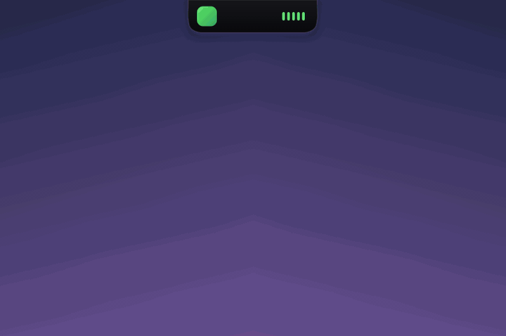
</p>

<p align="center">
  Native Rust &middot; no web view, no runtime &middot; a single ~1 MB exe &middot; GPU-drawn and vsync-locked (60 to 240 Hz)<br>
  No accounts, no tracking: your data stays on your PC.<br>
  <sub><a href="docs/demo.mp4">Full-quality demo (MP4, 60 fps)</a></sub>
</p>

---

## Meet Droppy

Droppy is Teardrop's mascot: a plump little droplet with two capsule eyes that look around and blink. It's the face of the app icon and logo, and the same eyes live in the island itself when you pick the **Eyes** idle look.

<p align="center">
  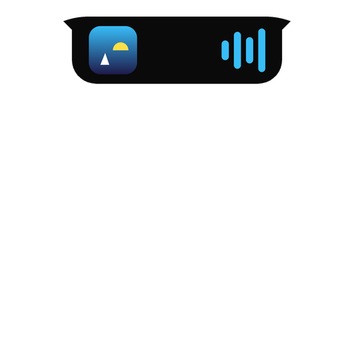
  &nbsp;&nbsp;&nbsp;
  
</p>

Brand files, mascot poses for each page and the drawing rules are in [docs/brand](docs/brand/README.md).

## What it does

**Collapsed**, the island resizes itself to fit what's going on:

| | |
|---|---|
| 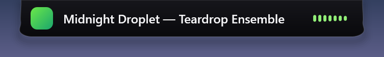 | **Music.** Artwork tile, the song title (it scrolls when it's long) and a live visualizer driven by what your speakers are actually playing. |
| 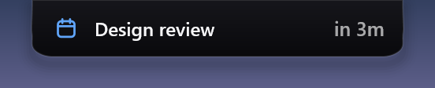 | **Meetings.** From 10 minutes before a calendar event, the title and a countdown take over. |
| 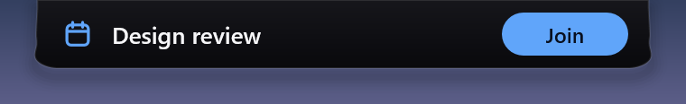 | **Meeting alert.** Five minutes before, a chime and a **Join** button. |
| 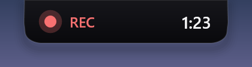 | **Recording.** A red dot and timer while the voice recorder runs. |
| 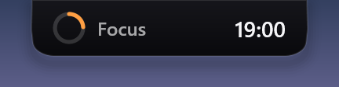 | **Focus.** A progress ring and countdown, even when you're on another page. |
| 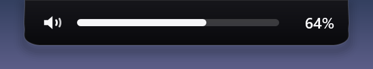 | **Volume.** A level bar that follows your volume keys and mute. |
| 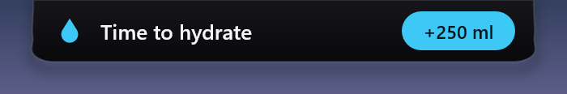 | **Reminders.** Click the island to log **+250 ml** (or press `W` anywhere). |
| 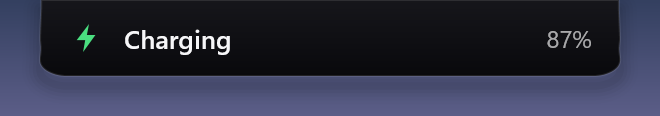 | **Power and devices.** Charging, battery level, a headset arriving. |
|  | **Idle.** A clock, a dot, nothing at all, or Droppy's eyes with a life of their own: they dance to music (on the real beat), doze off when you step away, react to your pointer, track changes, lock/unlock, downloads, screenshots and more. Five styles: round, cat, pixel, anime, robot. |

**Open it** by resting the pointer on it, clicking it, pressing `Win`+`Shift`+`T`, or dragging a file onto it. It doesn't scale a rectangle: it necks in where it hangs from the screen edge, swells into a bulb, then settles into a card.

<p align="center">
  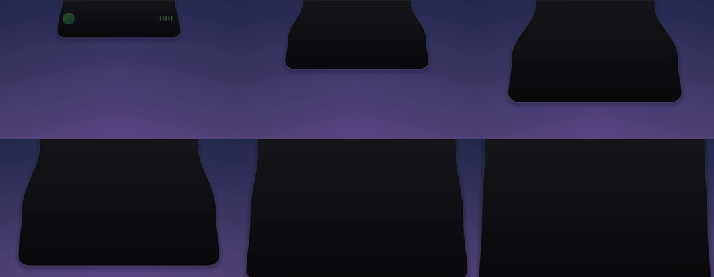
</p>

Move away and a hover-opened island folds back up. Click inside it and it stays pinned until you press `Esc` or click elsewhere.

### Drag a file onto it

The card splits into two drop zones and the one under your pointer lights up:

<p align="center">
  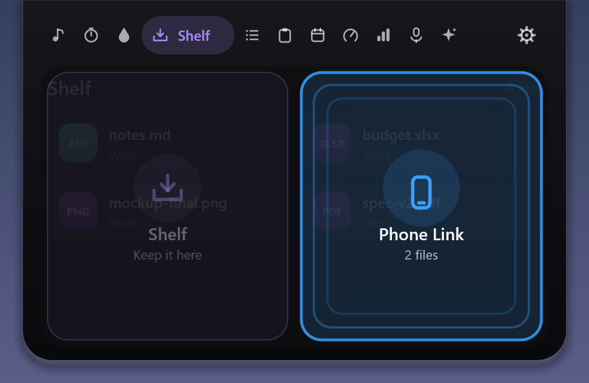
</p>

- **Shelf** keeps the file handy inside Teardrop.
- **Phone Link** opens the Windows share window with your files already loaded; pick Phone Link there to send them to your phone. Phone Link shows its own transfer progress. Folders are skipped.

## Pages

Scroll the mouse wheel over the header, or use `←` `→`, to switch. Everything is clickable, with hover and press feedback.

<table>
  <tr>
    <td width="50%">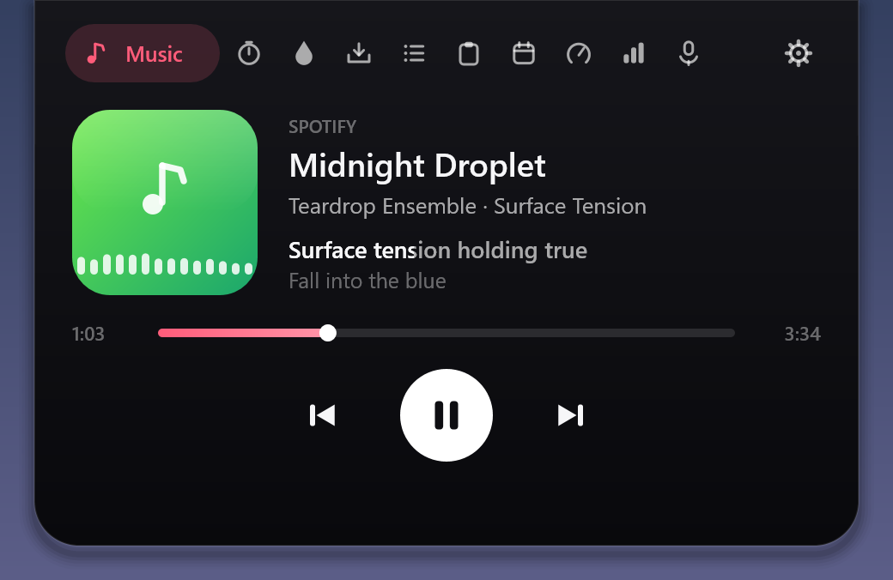<br><b>Music</b> &mdash; live info from any app that uses Windows media controls, real prev / play / next, click the progress bar to seek, a visualizer, and smooth time-synced lyrics with a karaoke highlight. YouTube titles are cleaned up so lyrics are found.</td>
    <td width="50%">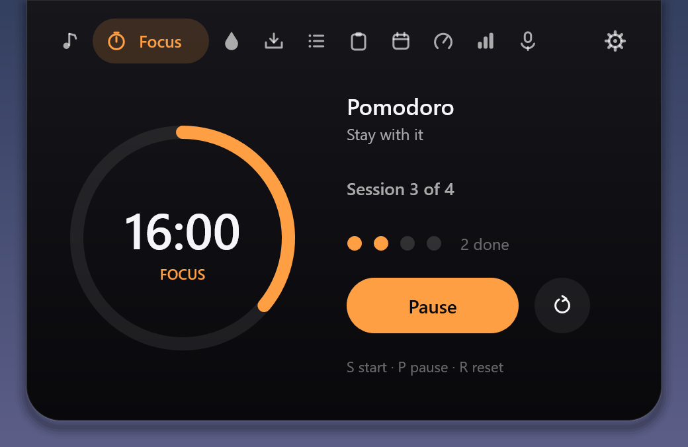<br><b>Focus</b> &mdash; a Pomodoro ring that keeps counting in the collapsed island. Adjustable length, cycle dots.</td>
  </tr>
  <tr>
    <td>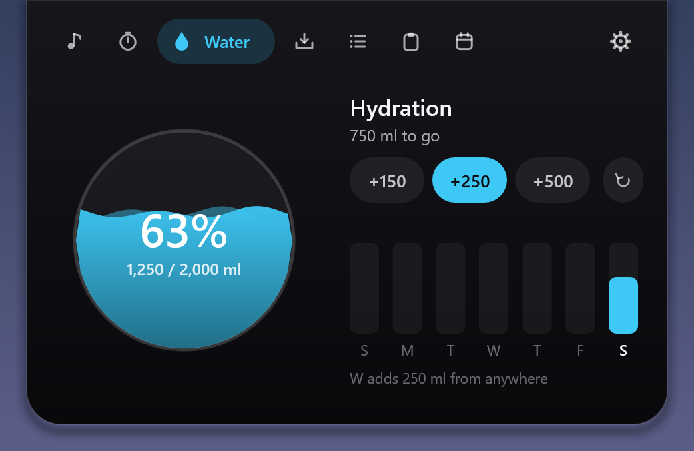<br><b>Water</b> &mdash; an animated glass, quick +150 / +250 / +500, undo, and a 7-day chart against your goal.</td>
    <td>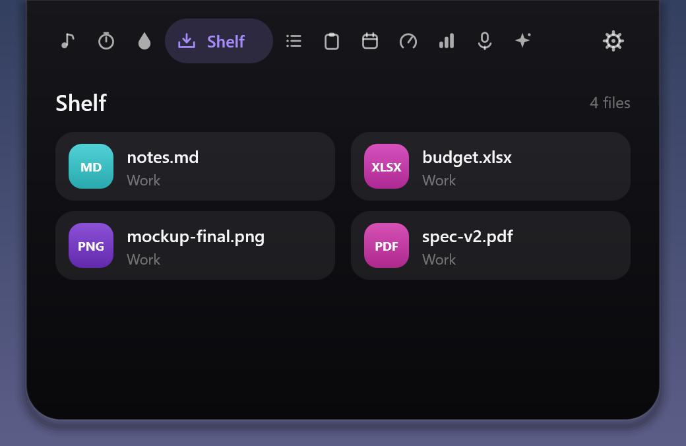<br><b>Shelf</b> &mdash; keep files handy. Click to open, drag out to Explorer or another app, reveal in Explorer, or remove. Voice recordings land here too.</td>
  </tr>
  <tr>
    <td>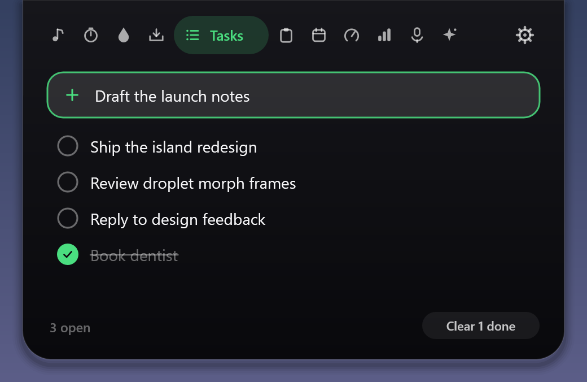<br><b>Tasks</b> &mdash; type to add, click to tick off, hover to delete.</td>
    <td>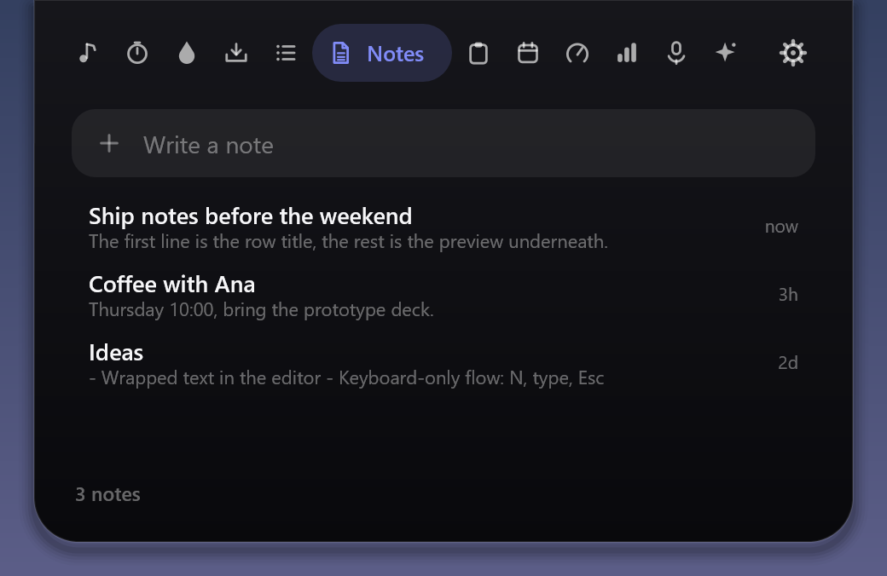<br><b>Notes</b> &mdash; a scratchpad with real paragraphs: the first line is the row title, the rest is the preview. Enter starts a new line, <b>Esc</b> closes (everything autosaves).</td>
  </tr>
  <tr>
    <td>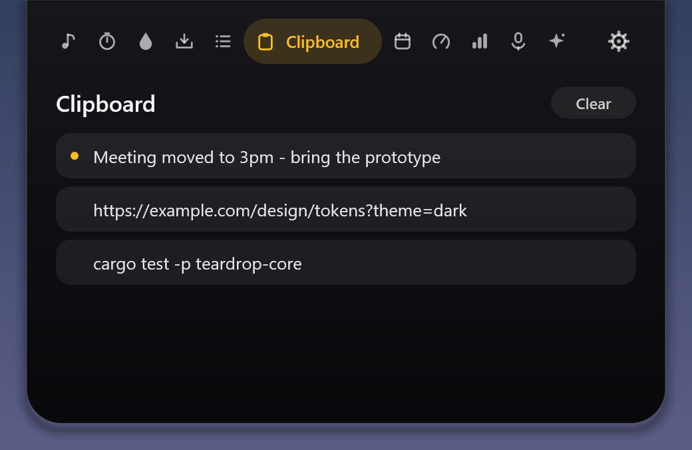<br><b>Clipboard</b> &mdash; recent text, in memory only. Click a row to copy it back.</td>
    <td>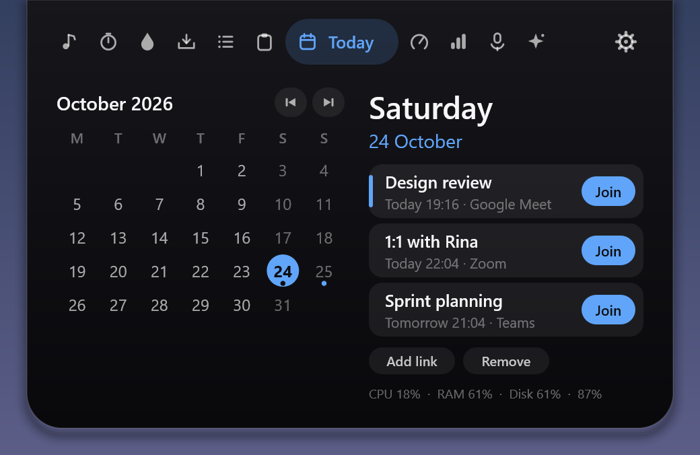<br><b>Today</b> &mdash; a month calendar you can browse, with a dot on days that have meetings, and your next meetings with <b>Join</b> buttons. See <a href="#calendar">Calendar</a>.</td>
  </tr>
  <tr>
    <td>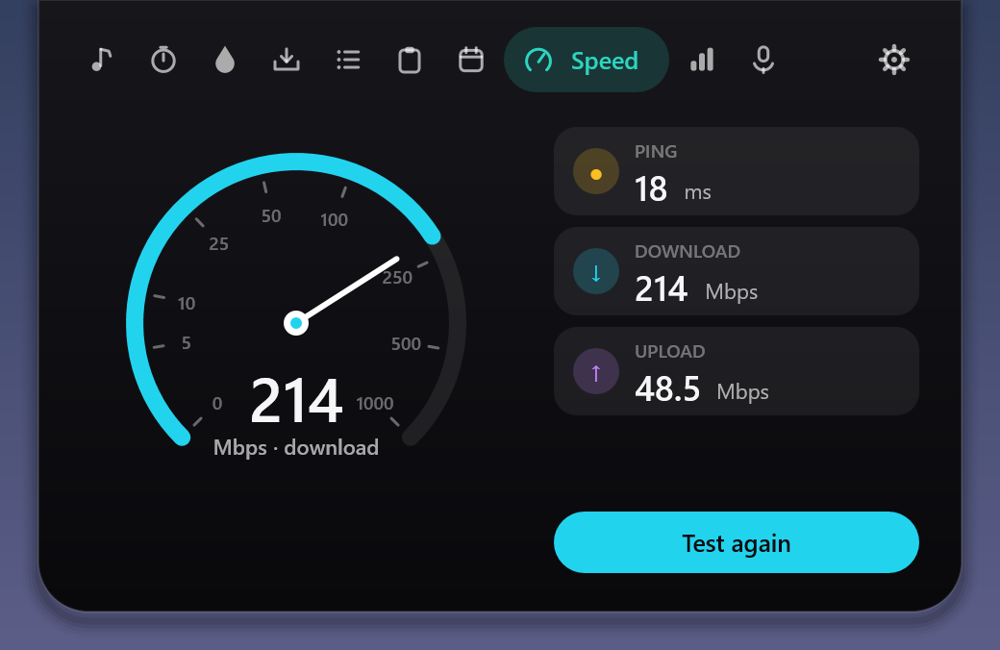<br><b>Speed</b> &mdash; an internet speed test in the style of Ookla's Speedtest: a dial and needle, a round <b>GO</b> button, and Ping / Download / Upload cards.</td>
    <td>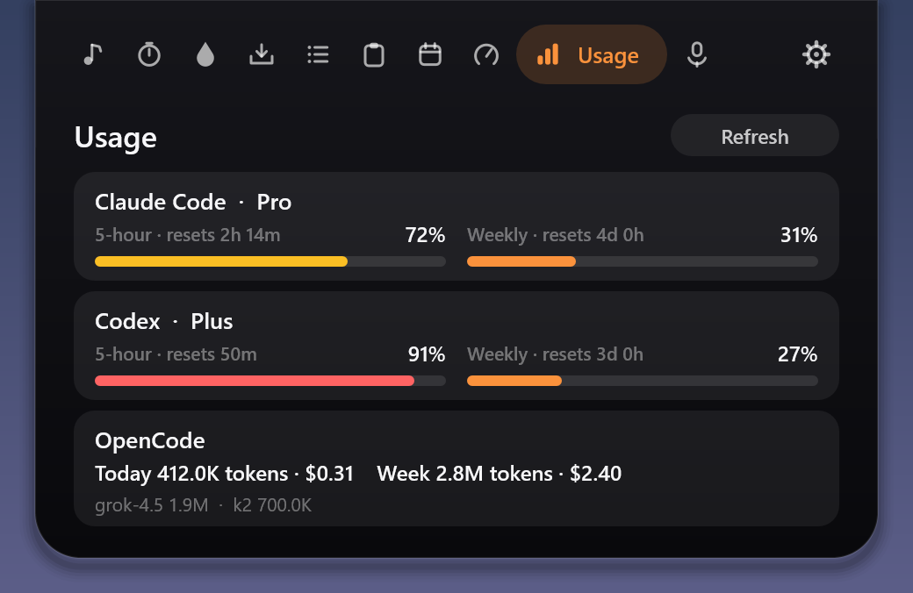<br><b>Usage</b> &mdash; your Claude Code and Codex 5-hour and weekly limits, plus OpenCode token and cost totals. See <a href="#ai-tool-usage">AI tool usage</a>.</td>
  </tr>
  <tr>
    <td>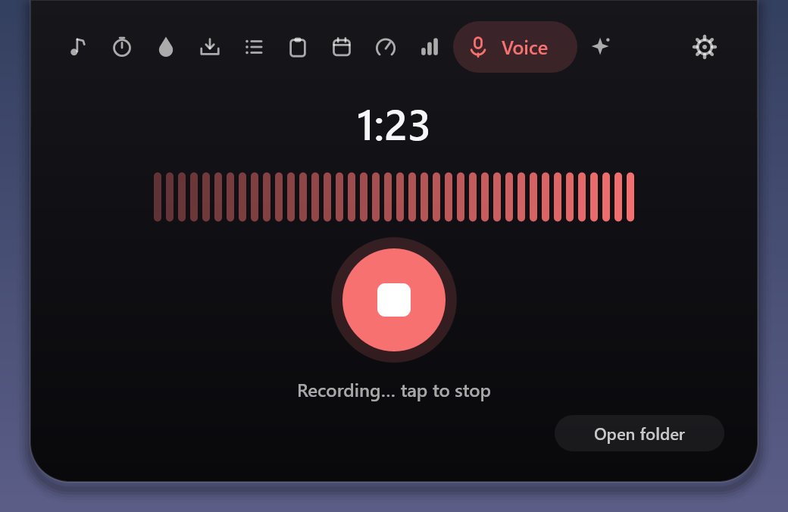<br><b>Voice</b> &mdash; one-tap microphone recorder with a live waveform. Saves a WAV file and puts it on your Shelf.</td>
    <td>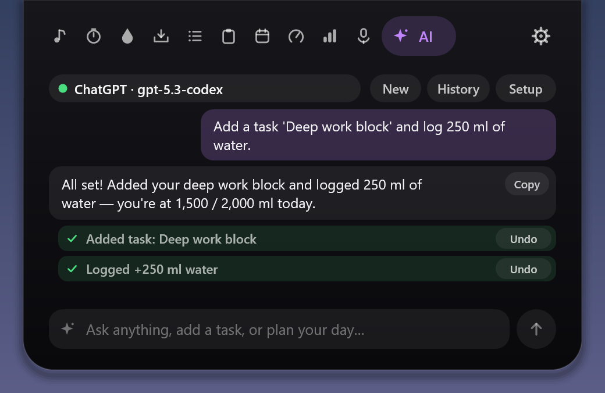<br><b>AI</b> &mdash; chat with an assistant that can see your day and act on it: add tasks, save notes, log water, start focus. Every action has an <b>Undo</b>. See <a href="#ai-chat">AI Chat</a>.</td>
  </tr>
  <tr>
    <td>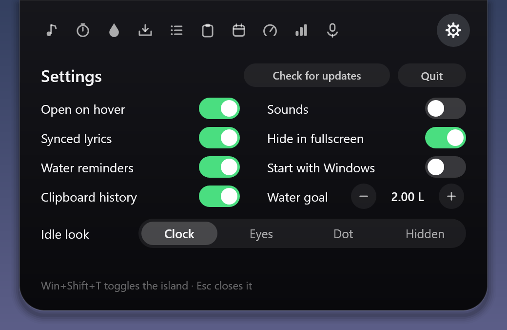<br><b>Settings</b> &mdash; behind the gear: hover-open, lyrics, reminders, history, sounds, fullscreen, start with Windows, water goal, idle look, and <b>Check for updates</b>.</td>
  </tr>
</table>

### Calendar

Teardrop reads your calendar through an **iCal link**, so there's no sign-in and no account:

1. Copy your calendar's iCal link.
   - **Google Calendar:** Settings → your calendar → *Integrate calendar* → *Secret address in iCal format*.
   - **Outlook:** *Settings → Calendar → Shared calendars → Publish a calendar → ICS*.
   - Any other `https://` or `webcal://` `.ics` link works too.
2. Open the **Today** page and press **Paste calendar link**.

You can add several calendars. Recurring events, exceptions, moved instances and time zones (IANA and Windows names) are handled. Feeds refresh every 15 minutes and the last result is cached, so your agenda still shows offline. Join buttons only appear for known meeting sites (Google Meet, Zoom, Teams, Webex, Whereby, GoTo) over https.

Limits: work or school Microsoft 365 calendars often have publishing turned off by the admin, so there's no link to copy. A feed can't tell Teardrop about your RSVP, so declined meetings still appear. The link is a secret: it's stored only in your settings file, never shown or logged, and Teardrop removes it from clipboard history after you paste it.

### AI tool usage

The **Usage** page reads data that's already on your PC and only starts when you first open it, then refreshes every five minutes:

- **Claude Code:** your plan and 5-hour / weekly utilization, from Anthropic's usage endpoint using your existing Claude Code sign-in. Your token is only ever sent to `api.anthropic.com`, is never stored or logged, and is never refreshed (so it can't sign you out of Claude Code). If it has expired, the page says *Open Claude Code to sign in again*.
- **Codex:** 5-hour and weekly limits that Codex writes into its own session logs. No token is read, and the numbers are as of the last time you used Codex.
- **OpenCode:** token and cost totals for today and the last 7 days, read from its local database.

### AI Chat

Bring your own account or key. Supported: **ChatGPT** (sign in with your subscription), **OpenCode Go**, any **OpenAI-compatible** server (OpenAI, OpenRouter, Groq, LM Studio, vLLM, llama.cpp), **Gemini**, **Claude**, and local **Ollama**. Open the **AI** page and press **Setup**.

- API keys and sign-in tokens are encrypted with Windows DPAPI in `%APPDATA%\Teardrop\ai-secrets.json`, so they only decrypt for your Windows user. They're never shown or logged.
- **ChatGPT** signs in with the Codex device-code flow, and reuses the tokens already in `~/.codex/auth.json` when it has none or they're newer, so a Codex CLI login counts as a Teardrop login. Tokens refresh in the background before they expire.
- **Sync models** asks the provider for its live catalog (`/models`) and remembers it in `%APPDATA%\Teardrop\ai-models.json`; the page also syncs on launch, so the picker shows the current model list (today that's `gpt-6.1-sol` first) instead of a bundled fallback. If a sync fails, the footer says why and the last known catalog stays in place.
- When *Share my day* is on (it's on by default), each message also carries a short summary of your day: upcoming calendar titles and times, open task titles, your latest note titles (never the note bodies), water and focus status, what's playing and basic PC stats. Turn it off to send only what you type. Nothing is sent until you press send.
- Actions the assistant takes inside Teardrop (add a task, log water, start focus) show up under its reply with an **Undo** button.

### Voice recorder

Recording only starts when you press the button. It captures your default microphone, saves a 16-bit WAV to `Music\Teardrop Recordings` and adds it to the Shelf so you can drag it into a chat or a folder. Nothing is uploaded. If Windows denies microphone access, the page says so. Recordings stop on their own after two hours.

### Keyboard

While the island is open and focused:

| Key | Action |
|---|---|
| `←` `→` / `Esc` | Switch page / close |
| `Space`, `N`, `B` | Music: play/pause, next, previous |
| `S`, `P`, `R` | Focus: start, pause/resume, reset |
| `W` | +250 ml water (works on any page) |
| `A` | New task (type, `Enter` to add, `Esc` to cancel) |
| `N` | Notes: new note (type, `Enter` for a new line, `Esc` when done) |
| `C` | Clear done tasks / clear clipboard history |
| `1`&ndash;`6` | Open a shelf file / copy a clipboard item |

## Smooth by design

- **Vsync-locked.** While anything moves, frames are paced by the compositor (`DwmFlush`), so it follows whatever your monitor runs: 60, 120, 144, 240 Hz.
- **GPU-drawn.** Direct2D renders on a D3D11 texture straight into a per-pixel-alpha layered window, so the shadow and edges are properly antialiased. A frame takes about 1 ms to draw. Machines without a GPU fall back to CPU rendering.
- **Fixed-step physics.** Springs advance at 240 Hz with a carried remainder, so motion speed is identical at every refresh rate and never judders.
- **Zero cost at rest.** Collapsed and idle means no frames at all. Equalizer and eyes use a gentle 30 fps timer.

## Privacy

Teardrop makes no accounts and sends no telemetry. It only talks to the network for features you use:

| When | What it contacts |
|---|---|
| A song plays (can be switched off in Settings) | [LRCLIB](https://lrclib.net) for synced lyrics, cached locally |
| Always, a few times a day | GitHub Releases to see if there's a newer version. It only downloads when you press **Update**, and checks the installer's SHA-256 first |
| You press **GO** on the Speed page | Cloudflare's public speed-test servers |
| You connect a calendar | Only the iCal links you pasted |
| You open the Usage page | Anthropic's usage endpoint, with your Claude Code sign-in |
| Weather mood is on (opt-in) | [wttr.in](https://wttr.in) |
| You send an AI Chat message | The provider you chose (see [AI Chat](#ai-chat) for what a message can include) |

Clipboard history lives in memory only and skips items that password managers mark as private. The microphone is only used while you're recording. Files you send to Phone Link go through the standard Windows share window.

Your data is in `%APPDATA%\Teardrop\`; cache and log are in `%LOCALAPPDATA%\Teardrop\`. The cache and log are safe to delete any time.

## Install

Download **`teardrop-setup-<version>.exe`** from the [Releases](https://github.com/Alg0rix/teardrop/releases) page and double-click it. It installs in a second, per-user (no admin rights, no wizard pages): it puts Teardrop in `%LOCALAPPDATA%\Programs\Teardrop`, adds Start menu and desktop shortcuts, sets it to start with Windows, and launches it. If Teardrop is already running, the installer closes it and updates it in place.

There's also a portable `.exe` and zip if you'd rather not install. Builds are unsigned, so Windows SmartScreen warns on first run: choose **More info → Run anyway**.

**Updates:** open Settings and press **Check for updates**. When a newer release exists, the gear shows a dot and a button offers **Update to vX**.

Uninstall from *Settings → Apps*. It removes the app and the cache and log, and keeps your data.

Prefer to build it yourself? See below, or run `tools\package.ps1` for `dist\teardrop.exe`, a portable zip and the installer (it uses [Inno Setup](https://jrsoftware.org/isinfo.php) if installed, otherwise [NSIS](https://nsis.sourceforge.io)).

## Build

Cargo workspace: `teardrop-core` (pure logic, unit-tested on any OS) and `teardrop` (the Windows app).

On Windows with Rust stable and the MSVC toolchain:

```
cargo test --workspace
cargo build -p teardrop --release        # target\release\teardrop.exe
```

### Testing without clicking around

```
teardrop.exe --selftest dist\selftest    # a PNG of every state + report.json
teardrop.exe --demo docs                 # re-render demo.gif / demo.mp4 (needs ffmpeg)
```

`--selftest` runs the real renderer headless and exits non-zero if a layout or logic check fails. The screenshots in this README come from it. Environment variables:

| Var | Effect |
|---|---|
| `TEARDROP_SELFTEST_DPI=144` | Render screenshots at 150% (default 192 = 2x) |
| `TEARDROP_PERF=1` | Log fps and render time to `teardrop.log` |
| `TEARDROP_CPU=1` | Force the CPU renderer |

See [ARCHITECTURE.md](ARCHITECTURE.md) for threads, the rendering model, page contracts and data files.

### CI

Workflows only run for the files they care about, so editing the README or docs doesn't start a Windows build:

| Changed | Runs |
|---|---|
| `crates/`, `Cargo.toml`/`Cargo.lock`, `installer/`, `tools/` | **CI**: clippy (bug classes: `correctness`, `suspicious`), tests, release build, installer build, headless selftest |
| `*.md`, `docs/` | **Docs**: every relative link, image and `#anchor` must resolve (`python tools/check_docs.py` to run it locally) |
| A published GitHub release | **Release**: builds and attaches the installer, portable exe/zip and checksums |

Run the same lint locally with `cargo clippy --workspace --all-targets -- -D clippy::correctness -D clippy::suspicious`.

## Status

Early. Developed and tested on Windows 11. The Shelf drags files out with OLE `DoDragDrop`, the music progress bar seeks through Windows media controls, and Phone Link hand-off uses the Windows share window (Phone Link has no public API for sending files or reporting progress).

## License

MIT. See [LICENSE](LICENSE).
